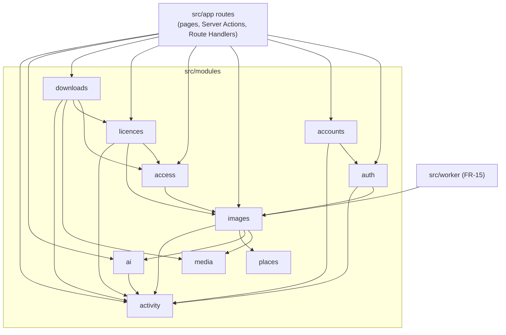
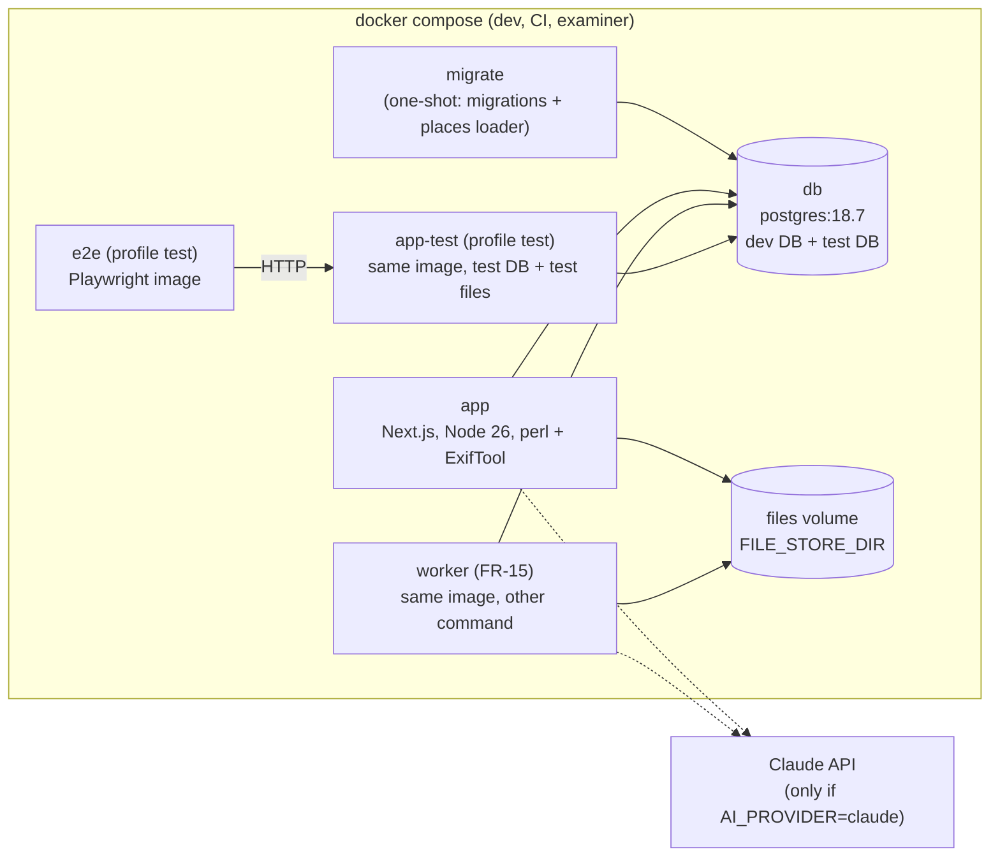
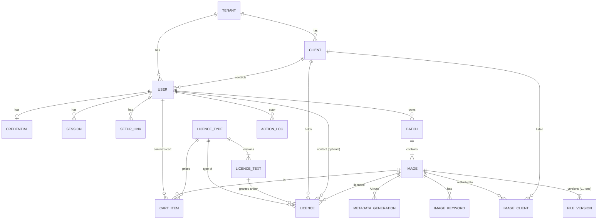

# Architecture Spine — CRM-DAM v1

## Design Paradigm

**Modular monolith, server-first.** One Next.js app. Code lives in domain modules under `src/modules/<module>/` that own their tables and rules; `src/app/` holds thin routes. Stories are vertical slices through the routes and the modules they need.



Arrows are the only allowed call directions between modules (no cycles). `media`, `places` and `activity` call no other module; `ai` calls only `activity` (settings changes). Only modules reach PostgreSQL; only `media` reaches the FileStore.

## Invariants & Rules

### AD-1 — One TypeScript full-stack app [ADOPTED]

- **Binds:** all
- **Prevents:** mixed-language units; a separate API service; starter defaults that fight the design.
- **Rule:** Next.js App Router, TypeScript, Designsystemet React for all UI (no Tailwind/shadcn; settles D-031), Drizzle on PostgreSQL. The worker is the same codebase and image. Scaffold with `create-next-app@16.4.6 --ts --app --src-dir --eslint --no-tailwind --no-cache-components --no-agent-feedback`. Designsystemet components are client components; pages stay Server Components and pass plain data down.

### AD-2 — Routes are thin; only modules touch the database

- **Binds:** all routes in `src/app/`
- **Prevents:** Drizzle queries in pages; rules re-implemented per route; non-atomic use cases.
- **Rule:** a route guards (AD-5), parses input with zod, then: a page or Server Component may call several module **read** functions; a mutation (Server Action or state-changing Route Handler) calls exactly **one** module write function, which owns the whole use case and its transaction. No business rule, database or FileStore access in `src/app/`.

### AD-3 — Module boundaries and table ownership

- **Binds:** all modules
- **Prevents:** hidden coupling; two writers of one entity.
- **Rule:** a module's public API is its `index.ts`; nothing imports another module's internals. Each table is defined in `src/db/schema/<owner>.ts` and written only by its owning module. Any module may *read* (select or join) any table by importing its schema object; writes go through the owner's functions. The seed writes through module functions too (AD-23).

| Module | Owns (writes) |
| --- | --- |
| auth | credentials (incl. `lastLoginAt`, `previousLoginAt`), sessions, setup_links, login_attempts (NFR-2b) |
| accounts | tenants, clients, users (staff and contacts: role, clientId, status, email, preferences) |
| images | batches, images, file_versions, image_keywords, image_clients, locks |
| licences | licence_types, licence_texts, licences, cart_items |
| ai | metadata_generations, ai_settings (FR-39) |
| places | places (GeoNames extract) |
| activity | action_log (FR-42a), append-only |
| access, downloads, media | no tables |

### AD-4 — Request transport, CSRF and caching

- **Binds:** all routes
- **Prevents:** unprotected or GET-triggered state changes; one user's data served from a cache to another.
- **Rule:** reads in Server Components; form mutations via Server Actions; file traffic (upload, thumbnail, preview, download, ZIP) and the state-polling endpoint via Route Handlers. **GET never writes**; a licence-granting download is a POST that responds with the file. Route Handlers reject any state-changing request whose `Origin` is missing or differs from `APP_ORIGIN`. Session cookie: `HttpOnly`, `SameSite=Lax`, `Secure` outside local dev. No `use cache`, `unstable_cache` or Cache Components on anything that depends on the session or access. File responses send `Cache-Control: private, no-store`.

### AD-5 — Auth is one module behind one seam; every entry point guards itself

- **Binds:** FR-2–FR-6, FR-38a, NFR-2a, NFR-2b, S1, S2, S6, S8
- **Prevents:** layouts mistaken for guards; a contact acting for another client; JWT sessions that cannot honour deactivation; a costly later swap to a library.
- **Rule:**
  - Auth alone touches sessions, cookies, password hashes and setup links: DB sessions with a random token in the cookie stored hashed; argon2id hashes; single-use setup links expiring after 7 days, a new link cancelling older ones (`auth.issueSetupLink(tx, userId)`, called by accounts when creating a user).
  - Every page, Server Action and Route Handler calls `requireStaff()` or `requireContact()` as its first statement; layout checks are display only. A guard returns an `Actor` `{ userId, role, clientId? }` and re-checks on every call that the user is active and, for a contact, that its client is active. A contact on a staff route gets 403 with no data.
  - Every module write function takes the `Actor` and asserts the role it needs. A contact's `clientId` and `userId` come only from the `Actor`, never from input.
  - Sessions expire server-side after 8 hours idle (`lastSeenAt`, updated at most once a minute); the state-polling endpoint does not refresh `lastSeenAt`. Setting a password ends the user's other sessions in the same transaction. Logout releases the user's edit locks (`images.releaseLocksOf`). Return-to after login is a validated same-origin relative path.

### AD-6 — The access module is the only authority on what a client gets

- **Binds:** FR-6, FR-21, FR-22, FR-24, FR-26, FR-28–FR-30, FR-33, FR-38a, NFR-2a, NFR-9, A1–A13, S4, S12
- **Prevents:** per-route access logic; lists, counts and pages that disagree; staff-only fields or location reaching a client; 403 leaking existence.
- **Rule:**
  - One SQL condition "visible to client X" plus computed flags, used by **every** client-facing image list, count, search, page, thumbnail, preview and download. Visible = published and (public, or restricted with the client on the list), or own. **Own** = the client holds an active licence, or the image is published, free, not archived and restricted to a list that includes the client. Restricted with an empty list behaves as internal-only.
  - Client routes get image data only from access, as a `ClientImage` built from a fixed column list (agency fields, date taken, camera data, dimensions, price, `own`/`canDownload`/`canBuy`) — never GPS, place name, staff notes, client lists or provider data. `getClientImage(actor, imageId)` returns `ClientImage` or `null`; every route turns `null` into 404.
  - Price shown to a client is `{ licenceTypeId, priceMinor, currency }` from the current licence type for a paid image, `Free` otherwise.
  - Client search matches title, description, alt text and keywords; place name is added only if `clientMaySeeLocation()` allows it, which returns false in v1.
  - "Visible since" for FR-38a = the latest of `publishedAt`, `visibleToAllSince` and the client's `image_clients.addedAt`.
  - Licence history (FR-33) is the one client list not filtered by visibility: it reads the client's licences with their stored title; a row links to or shows the image only when `getClientImage` is non-null, otherwise "removed by the agency" (revoked) or the title as text.

### AD-7 — Access tests run through real routes

- **Binds:** SC-1, SC-6, every story touching access, licences or guards
- **Prevents:** per-story ad-hoc access tests; order-dependent tests; SC-1 shortfall.
- **Rule:**
  - One shared seed fixture (`src/db/seed/fixture.ts`: one image per A-row and per S-rule, the location test files, a `fail` image) and a `loginAs` helper, built in the first auth story.
  - **Read rules** (A1–A13, S1–S4, S6, S12, S15) are table-driven HTTP tests with the Playwright request API (sending an `Origin` header): each A-row through image page, thumbnail, preview, download, My images, Find images, counts and search.
  - **Mutation rules** (S5, S7, S9, S11, S13, S14) are tested at the module write function the Server Action calls, against a real database, plus one browser test per rule that submits the real form. S5 also runs as parallel transactions.
  - A guard test calls every staff Route Handler as a contact (expects 403) and every module write function with a contact `Actor` (expects `Forbidden`).
  - Each e2e run starts from a freshly migrated and seeded test database and an empty test file directory. Tests that change state create their own rows through fixture factories, never the matrix rows.

### AD-8 — Image state: columns, guarded transitions, optimistic concurrency

- **Binds:** FR-10b, FR-15–FR-21, FR-25, FR-26
- **Prevents:** combined-state explosion; races between transitions; lost updates (e.g. a form save re-adding a revoked client).
- **Rule:**
  - `status` (draft | published | archived) and `processingState` (uploading | queued | generating | ready | failed) are separate columns. `publishedAt` is set by the first publish and never cleared; restore returns to `published` if it is set, else `draft`; discard (FR-20) requires `publishedAt is null`. "Rejected" is never stored.
  - Every transition is one conditional `UPDATE … WHERE <precondition> RETURNING`; 0 rows throws `Conflict`. Never select-then-update. Publish requires `processingState in (ready, failed)` and `nameMatchOf is null` (FR-10b undecided match); never back to draft; retry requires `status = draft and processingState = failed`.
  - Metadata edits are allowed only when `processingState` is `ready` or `failed`.
  - Images and batches carry `version int`. Every staff save sends the version it loaded and updates `WHERE version = $v`, bumping it; a mismatch throws `Conflict`. Restricted-list changes from a form are sent as a diff (added/removed). This holds whether or not FR-18 is built.

### AD-9 — Batch settings are copied, never inherited

- **Binds:** FR-8, FR-9, FR-12, FR-19b, FR-21
- **Prevents:** access or generation reading settings from two places; batch edits changing images without confirmation.
- **Rule:** every image belongs to exactly one batch (`batchId NOT NULL`); a single upload is a batch of one. The batch row holds defaults only. They are copied onto each image when its row is created (visibility, `image_clients`, `priceTier`, `aiEnabled`, `placeNamesToAi`, shared keyword rows). Access, generation and retry read only the image's own columns. `images.applyBatchSettings` is the only way batch values reach existing images, and it replaces only the fields it names.

### AD-10 — Agency fields carry their source; two save shapes

- **Binds:** FR-9, FR-11, FR-12, FR-14, FR-16b, FR-17, AS-7, D-033, SC-7, SC-13
- **Prevents:** a retry or apply-to-all overwriting staff edits; keyword limits counted over the wrong set; autosave writing stale values back.
- **Rule:**
  - Title, description and alt text each store a source (`embedded | ai | staff`). Keywords are `image_keywords` rows `{ keyword, source: embedded | shared | ai | staff, category? }`, unique on `(imageId, lower(keyword))`; `category` is set for `ai` rows only.
  - Writes go through three images actions: `saveAiResult` replaces only fields whose source is not `staff` and only `embedded`/`ai` keyword rows, with FR-14's 15-keyword limit counted over `ai` rows; `applyBatchSettings` replaces only `shared` rows and the named settings; staff edits are **patches** of the changed fields, each written with source `staff`.
  - Two save shapes (D-033): `images.updateDraftField` for Upload autosave (one field per call; returns the saved value or an error, the client keeps its value) and `images.saveImageEdits` for Library Save changes (all fields at once, per-field validation errors). No autosave path exists for non-draft images.

### AD-11 — Upload: row first, file work outside transactions, duplicates decided atomically

- **Binds:** FR-8, FR-10a, FR-11, FR-13, FR-15, NFR-10
- **Prevents:** orphan rows and files; duplicate images from parallel identical uploads; long transactions.
- **Rule:**
  - The browser first asks for an image row (`uploading`, filename, batch, uploader), visible to all staff.
  - The file streams to `tmp/<uuid>` in the FileStore with its SHA-256 computed in-stream; media then derives thumbnail and preview (AD-14) — all outside any transaction.
  - One short transaction then inserts the `file_versions` row (hash, `mediaType`, `byteSize`, oriented `width`/`height`). A unique-index conflict (`hash where hash is not null`) deletes the image row, and media deletes the files (the uploader sees Rejected). Otherwise the files are moved to their final keys, embedded metadata is stored, the place name is derived from GPS for **every** image (FR-13, if built) whatever its AI choice, and the image moves to `queued` (AI chosen) or `ready`.
  - An interrupted upload deletes its row and files. The stored original's hash never changes (NFR-10).
  - The app's startup sweep deletes `uploading` rows not touched for an hour and clears `tmp/`.

### AD-12 — Generation: the image table is the queue, with a lease

- **Binds:** FR-12, FR-14, FR-15, FR-16a, FR-16b, FR-39
- **Prevents:** two generation code paths; row locks held across a 30 s call; double generation; images stuck in `queued`/`generating`; AI text landing on a published image.
- **Rule:**
  - `images.generateMetadata(imageId)` is the only generation path, in three steps, never one transaction:
    1. **Claim** (short transaction): set `generating`, a new `generationToken` and `leaseUntil = now + 2 × provider timeout`, picking with `FOR UPDATE SKIP LOCKED`.
    2. **Generate** (no transaction): media makes the AI input; `generateMetadata` builds the text input from the stored embedded metadata and place name. When `placeNamesToAi` is off, it omits the place name and filters coordinates and location fields out with media's location checklist. Then ai runs.
    3. **Save** (short transaction): `saveAiResult … WHERE generationToken = $token AND status = draft`; 0 rows discards the result.
  - Without FR-15, the upload flow calls it inline after completion, and at app start every `queued` image and every `generating` image with an expired lease becomes `failed` (reason "interrupted"). With FR-15, the worker (same image, own Compose service) claims `queued` images and reclaims expired leases, `WORKER_CONCURRENCY` (default 2) at a time; only the worker touches `queued`/`generating` at startup. No queue library.

### AD-13 — Live state and the upload queue

- **Binds:** FR-15, AS-23, UX processing tags, NFR-5a
- **Prevents:** uploads dying on tab switch; push infrastructure; progress writes to the database; screen-reader floods.
- **Rule:** the upload queue lives in a client provider in the staff layout, so uploads survive navigation between staff pages; leaving the app while files upload warns first. Upload percentage is browser-local and shown only to the uploader, on Upload and Library tiles; other staff see "Uploading" without a percentage. Pages showing processing state poll one Route Handler about every 3 s; tiles update silently and one live region announces aggregated changes at most once per poll.

### AD-14 — Edit locks live in the images module (FR-18, bonus)

- **Binds:** FR-17, FR-18, AS-11, D-033
- **Prevents:** per-route lock checks; conflicting simultaneous locks; saves from an expired lock.
- **Rule:** `lockedBy`/`lockedUntil` on images and batches. Edit mode (Library) or the first edit (Upload) takes the lock; it renews at most once a minute while the user types and on each save, to `now + 15 min`. Every staff save action checks `lockedBy = actor and lockedUntil > now`, else `Locked` (the client keeps its value). An image lock blocks its batch's settings; a batch lock blocks all its images; image locks in one batch do not conflict; a lock is taken in one transaction that locks the batch row. Release on save, cancel, discard, leaving the editor (best effort) and logout; expiry is the backstop. Generation, revoke and retry neither take nor respect locks — AD-8's `version` check protects edits. Without FR-18 the lock check is absent.

### AD-15 — One storage interface, owned by media

- **Binds:** FR-8, FR-34–FR-37, FR-43, NFR-2a, NFR-3
- **Prevents:** public paths to originals; storage calls scattered through the code; a rewrite to move to object storage.
- **Rule:** a `FileStore` interface (put, get, move, delete as streams) used only by media. Keys are app-generated (`tmp/<uuid>`, `originals/<fileVersionId>`, `derived/<fileVersionId>/<kind>`), never from upload filenames. v1 implementation: local disk on a Docker volume at `FILE_STORE_DIR`. Every file reaches a browser through a Route Handler that asks access (client) or the staff guard first. Only an image's latest file version is shown or downloaded.

### AD-16 — File pipelines and the metadata contract

- **Binds:** FR-11, FR-12, FR-17, FR-34–FR-36, NFR-2a, NFR-6, D-011, D-028, SC-16
- **Prevents:** metadata-bearing previews; re-encoded downloads; a modified original; stale edited values in copies; sideways photos.
- **Rule:**
  - The original is never modified.
  - **Derived files** (sharp; auto-orient first): thumbnail, preview (≤ 800 px) and AI input (1568 px long edge, sRGB). Thumbnails and previews keep only the ICC profile; the AI input keeps no metadata at all. Previews are stricter than the addendum: they carry no agency metadata. Thumbnails and previews are made once at upload and shared by staff and clients.
  - **Client copy:** original pixels untouched; ExifTool removes all metadata, copies back only the FR-35 whitelist plus EXIF `Orientation`, then writes the current agency fields. **Staff copy:** original bytes plus all current metadata, including location.
  - For every field staff can edit (agency fields, date taken, GPS, place name), the image row is the source written into copies, never the original's embedded value.
  - Metadata follows the addendum's metadata contract: XMP always, full values; IIM values shortened **by the app** to their byte limit at the last whole word, else the last whole character (D-028), with `IPTC:CodedCharacterSet = UTF8` and keywords over 64 bytes left out of IIM only; PNG gets XMP and no IIM.
  - Values go through exiftool-vendored's write API, never into a command line; control characters are removed first. Embedded metadata and AI output are rendered only as escaped React text, never `dangerouslySetInnerHTML`.

### AD-17 — Client files fail closed on location data

- **Binds:** FR-35, FR-36, FR-37, NFR-10, SC-6
- **Prevents:** a location leak through an unexpected tag; a partial file served.
- **Rule:** media checks every file a client can receive against the location checklist from the metadata research. Thumbnails and previews are checked once, when made; a hit fails that image's upload completion. Client and staff copies are built on demand into a temp file, never cached, and each client copy is checked before streaming. A hit or any build error gives an error response; nothing is streamed until the copy is complete and checked.

### AD-18 — Licences: one writer, one grant path, facts copied

- **Binds:** FR-23–FR-25, FR-33, FR-40, FR-41, NFR-9, S3, S5, S11–S15
- **Prevents:** a second licence writer; duplicate active licences; a licence changing meaning when price, text or visibility changes; lost history.
- **Rule:**
  - `licences.grantLicence(tx, actor, …)` is the only way a licence is created; it returns `{ licence, created }`. S5: partial unique index on `(clientId, imageId) where revokedAt is null`, insert with on-conflict-do-nothing.
  - Each licence stores client, contact (nullable), `source` (purchase | free_download | staff_grant), image, image title at the time, licence type, the `licence_texts` version id, price in minor units, currency and timestamp. Licence texts are immutable versions.
  - An image stores only `priceTier` (free | paid). A paid image's price is its licence type's current price.
  - The licences table is the transaction log. Revoke sets `revokedAt`, `revokedBy`, reason and credit flag, never deletes, and removes the client from the image's restricted list in the same transaction through images (bumping its `version`).

### AD-19 — Checkout and free downloads are all-or-nothing

- **Binds:** FR-23, FR-31, FR-32, FR-37, NFR-7, NFR-10
- **Prevents:** partial checkouts; licences without a deliverable file; a cart that fails the same way twice.
- **Rule:**
  - Cart lines store `licenceTypeId`, the seen price and currency.
  - One client's checkouts and free first downloads run one at a time (`pg_advisory_xact_lock` on the client id).
  - Checkout is one transaction that re-checks every line through access (still buyable, not already held, same price). If anything changed, no licence is recorded; in its own transaction the cart drops unavailable, now-free and already-held lines and stores new prices, then the NFR-7 messages are returned. Otherwise every licence is granted and the cart emptied. The single-image fallback is the same code with one line.
  - A free first download (POST) builds and checks the client copy, then grants the licence, then streams. The `downloads` module orchestrates this.

### AD-20 — Cross-module writes share one transaction; the action log is append-only

- **Binds:** all multi-module writes; FR-38b, FR-42a, FR-42b
- **Prevents:** half-applied writes across modules; log entries without their action, or edited later.
- **Rule:** module write functions take a `tx` (Drizzle transaction or db) as their first argument. The module function that owns the use case opens the transaction and passes it on; no module opens a transaction inside another module's call. `activity` exposes only `record(tx, entry)` and read functions. Entries hold actor, action (enum), `subjectType` + `subjectId` (no foreign key), optional `clientId` and `imageId` (no foreign key), a snapshot label and a timestamp.

### AD-21 — AI behind one provider port

- **Binds:** FR-12, FR-14, FR-16a, FR-39, NFR-1, NFR-4, NFR-8, NFR-9, D-017, D-021
- **Prevents:** provider logic in the upload flow; adapters reading files or the database; lost comparison data; leaked keys.
- **Rule:**
  - The ai module's generation side is pure: input = AI image, media type, metadata text, output language; output = title, description, altText and `keywords: { term, category }[]` (FR-12's seven categories) plus usage, or a typed error.
  - The app owns the versioned prompt and schema (v3); adapters in `src/modules/ai/providers/` only translate them and are registered in one list. Shared output checks (FR-14) run on every provider's output.
  - Every run is recorded in `metadata_generations` (provider, model, prompt version, tokens, latency, result or error category, raw output); "How the metadata was made" reads the latest successful run.
  - Provider, model, effort and key are resolved per job: `ai_settings`, else environment defaults. Timeout 30 s with no SDK retries (`maxRetries: 0`), so 30 s is the bound; retry is the staff action FR-16b. Error categories: `auth`, `rate_limit`, `timeout`, `unavailable`, `refused`, `invalid_output`, each with one NFR-7 reason.
  - FR-39 key: AES-256-GCM with `APP_ENCRYPTION_KEY` (node:crypto), decrypted only inside ai, never logged or sent to the browser; the settings page gets only `hasKey` and the last 4 characters.

### AD-22 — The mock is the default provider

- **Binds:** NFR-1, FR-16a, SC-13, AD-7
- **Prevents:** tests or the examiner needing a key or network.
- **Rule:** `AI_PROVIDER=mock` by default. The mock returns fixture metadata per seed image (covering all seven keyword categories) and labelled placeholder metadata otherwise, waits `MOCK_DELAY_MS`, records the input it received (for SC-13), and fails on demand when `MOCK_FAIL=true` or for a filename containing `fail`. Every adapter passes the same contract tests against recorded responses.

### AD-23 — Place names from a committed GeoNames extract (FR-13, bonus)

- **Binds:** FR-12, FR-13, AS-8
- **Prevents:** runtime network lookups; model-invented places; environments without place data.
- **Rule:** a kept script builds a compressed extract (Norwegian populated places with municipality and county from the current `admin1CodesASCII`, world cities over 15,000) that is committed in `data/places/` with its download date. An idempotent loader in the `migrate` service fills `places`, independent of seeding. Lookup: nearest place within a radius via a lat/lon index and a distance formula in SQL; otherwise country only. GeoNames is credited (CC BY 4.0) in the README, beside the data file and on the staff help page.

### AD-24 — Runtime envelope: Docker Compose, offline at runtime

- **Binds:** NFR-1, NFR-3, NFR-4, D-027, RG-1
- **Prevents:** "works on my machine"; network or keys needed to run or test; seeded users in real use; diverging schemas between worktrees.
- **Rule:** see *Deployment & environments*. Only building images needs the network; fonts are self-hosted via `next/font`. All configuration comes from environment variables, and `.env.example` lists exactly those below; secrets never appear in code, logs or the repository. Uploaded files and generated data stay out of git. Schema changes only via `drizzle-kit generate` as committed SQL, forward-only; never `push`, never edit an applied migration; regenerate after rebasing if the journal conflicts. The seed writes through module functions with the mock provider, from `src/db/seed/images/` with a source and licence list; seed users have documented demo passwords. `.gitattributes` forces `eol=lf` on scripts and Dockerfiles.

## Consistency Conventions

| Concern | Convention |
| --- | --- |
| IDs | UUID v7 from Postgres `uuidv7()`; never sequential IDs in URLs |
| Tenancy | constant `DEFAULT_TENANT_ID` in `src/db/tenant.ts`; `tenantId` NOT NULL on top-level tables (users, clients, batches, images, licence_types, licences, cart_items, action_log); no scoping code in v1 |
| Money | integer minor units + ISO 4217 currency, always excluding VAT; never JS floats |
| Time | system timestamps `timestamptz` UTC, shown in Europe/Oslo. Date taken: `timestamp without time zone` + optional offset, shown and written back as captured or edited |
| Coordinates | `latitude`/`longitude` on the image; place name in separate columns (place, municipality, county, country) |
| Naming | tables snake_case plural; TS camelCase; module folders lower-case domain nouns; one `actions.ts` per route segment |
| Validation | zod at the route boundary; emails trimmed and lower-cased, unique on `lower(email)`; `ALT_TEXT_MAX = 250` is one shared constant |
| Errors | modules throw `NotFound`, `Forbidden`, `Conflict`, `Validation`, `Locked`, each carrying a message key; one shared helper maps them to HTTP status / form state and NFR-7 text; unexpected errors are logged and shown as a generic message that says what to do next |
| Idempotency | duplicates prevented by unique constraints; creates without a natural key carry a form nonce stored with a unique index; races prevented by conditional updates and `version` (AD-8) |
| Deletes | foreign keys `on delete restrict`, except derived rows that cascade from an image (file_versions, image_keywords, image_clients, metadata_generations); only FR-20 deletes an image, after which media deletes its files |
| Lists | `?page=` offset paging, 1-based, page size 48 for image grids and 50 for tables, total count from the same condition, empty state always (NFR-7) |
| Search | one `buildSearchCondition(terms, fields)` in images, used by staff search and by access with the client field set; terms split on whitespace, case-insensitive, all must match; order `createdAt desc, id desc` |
| Display | one `displayTitle()` / `altFor()` helper in images (title fallback, "Untitled image") used by every list and page |
| Logging | pino; never log passwords, tokens, setup links or API keys; the action log is a table, not log output |
| Text | next-intl; every UI string and NFR-7 message in `messages/en.json`; no locale segment in URLs in v1 |

## Stack

| Name | Version |
| --- | --- |
| Node.js | 26 LTS (26.13.x) |
| Starter | create-next-app 16.4.6 (flags in AD-1) |
| TypeScript | 5.9.3 |
| next | 16.4.6 |
| react / react-dom | 19.3.1 |
| @digdir/designsystemet-react / -css / -web | 1.24.0 |
| PostgreSQL | 18.7 |
| drizzle-orm / drizzle-kit | 0.45.4 / 0.31.11 |
| pg (node-postgres) | 8.23.1 |
| @node-rs/argon2 | 2.2.2 |
| zod | 4.6.7 |
| next-intl | 4.14.9 |
| sharp | 0.35.5 |
| exiftool-vendored | 39.2.0 |
| yazl (ZIP, FR-37) | 3.3.1 |
| pino | 10.4.0 |
| @anthropic-ai/sdk | 1.7.0 |
| Claude model | claude-haiku-5-5, effort medium |
| vitest | 5.1.0 |
| @playwright/test / @axe-core/playwright | 1.65.0 / 4.14.0 |
| Playwright image | mcr.microsoft.com/playwright:v1.65.0-noble |
| Docker Compose | v2 |
| GeoNames extract | dump of the build date, CC BY 4.0 |

## Structural Seed

### Deployment & environments



- `docker compose up` gives a running app with seed data and the mock provider. `db` has a healthcheck; `migrate` waits for it; `app` and `worker` wait for `migrate` (`service_completed_successfully`); `app` exposes `/api/health`.
- The app image installs Debian's full `perl` package (not only `perl-base`) for ExifTool; `next.config` lists `exiftool-vendored` and `sharp` in `serverExternalPackages`; the foundation story verifies ExifTool writes UTF-8 IIM in the image. The Postgres volume mounts `/var/lib/postgresql` (Postgres 18 layout).
- Seeding runs only on an empty database while `SEED_ON_START=true` (dev default; off for real use, RG-1).
- Tests: Vitest against the test database (`TEST_DATABASE_URL`); the `test` profile runs `app-test` and `e2e` after resetting the test database and file directory (AD-7). CI (GitHub Actions, x86 Linux) runs the same Compose setup.
- Environment variables: `DATABASE_URL`, `TEST_DATABASE_URL`, `APP_ORIGIN`, `FILE_STORE_DIR`, `AI_PROVIDER`, `ANTHROPIC_API_KEY`, `AI_MODEL`, `AI_EFFORT`, `MOCK_DELAY_MS`, `MOCK_FAIL`, `WORKER_CONCURRENCY`, `SEED_ON_START`, `APP_ENCRYPTION_KEY` (FR-39 only).
- `scripts/generate-scale-data.ts` builds the NFR-4 data set (500 images, 10 clients) into a separate database; never committed.

### Core entities



`places`, `ai_settings` and `login_attempts` stand alone.

### Source tree

```text
src/
  app/            # routes only: (staff)/, (client)/, api/ Route Handlers
  modules/
    auth/ accounts/ images/ access/ licences/ downloads/
    media/ ai/ ai/providers/ places/ activity/
  db/
    schema/       # one file per owning module
    migrations/   # drizzle-kit output, committed
    seed/         # fixture.ts, images/ + SOURCES.md, seed runner
    tenant.ts
  worker/         # FR-15 worker entry
messages/en.json  # all UI strings
tests/e2e/        # access matrix, guard tests, axe scans
data/places/      # GeoNames extract, credit note, build script
scripts/          # generate-scale-data.ts
```

## Capability → Architecture Map

| Capability / Area | Lives in | Governed by |
| --- | --- | --- |
| F1 Accounts and clients (FR-1–FR-7) | auth, accounts | AD-3, AD-5 |
| F2 Upload and metadata (FR-8–FR-20) | images, media, ai, places | AD-8–AD-14, AD-16, AD-21–AD-23 |
| F3 Access and licences (FR-21–FR-26) | access, licences, images | AD-6, AD-7, AD-18, AD-20 |
| F4 Search and browse (FR-27–FR-30) | images (staff), access (client) | AD-6, Conventions (Search, Lists, Display) |
| F5 Cart and checkout (FR-31–FR-33) | licences | AD-18, AD-19, AD-20 |
| F6 Downloads (FR-34–FR-37) | downloads, media | AD-15–AD-17, AD-19 |
| F7 Client dashboard (FR-38a/b) | access, licences, activity | AD-5, AD-6, AD-20 |
| F8 Admin and settings (FR-39–FR-42b) | ai, licences, activity | AD-18, AD-20, AD-21 |
| F9 Versions (FR-43, stretch) | images, media | AD-11, AD-15 (file_versions seam) |
| NFR-1, NFR-3 Runnable without keys, privacy | compose, seed, ai mock | AD-22, AD-24 |
| NFR-2a/b Security, login delay | auth, access, media | AD-4, AD-5, AD-6, AD-15, AD-16 |
| NFR-4 Scale | images, access, ai | AD-6, AD-12, AD-21, Conventions (Search) |
| NFR-5a/b Accessibility | UI (Designsystemet React), e2e | AD-1, AD-7, AD-13 |
| NFR-6 Metadata standard | media, ai | AD-16, AD-21 |
| NFR-7, NFR-8 Errors, language | all | Conventions (Errors, Idempotency, Text) |
| NFR-9 Data model for later stages | all | AD-6, AD-15, AD-18, Conventions |
| NFR-10 Integrity | images, licences, downloads | AD-11, AD-17, AD-19 |

## Deferred

- **Hosting, backups, monitoring and incident response** — RG-1, RG-2, RG-13 before real use. The host must run containers with a volume and a long-running worker; an S3-compatible `FileStore` is added then.
- **Email sending** — RG-12; v1 shows setup links to staff.
- **Erasure, people-in-images, consent records** — RG-4, RG-5; v1 never deletes published images or licences.
- **Norwegian language pack** — after v1; the messages file and the output-language input are the seams.
- **Map search and client location** — later stage; `clientMaySeeLocation()` is the seam.
- **More AI providers (Gemini, local)** — stage 2; one adapter each behind AD-21.
- **FR-43 new versions** — stretch; `file_versions` exists from v1, the upload-new-version flow is not designed.
- **Page layout and component choice** — owned by the UX spec (`DESIGN.md`, `EXPERIENCE.md`).
- **Search matching technique** (ILIKE vs Postgres full-text) — inside `buildSearchCondition` only; NFR-4's 1 s target decides it in the first search story.
